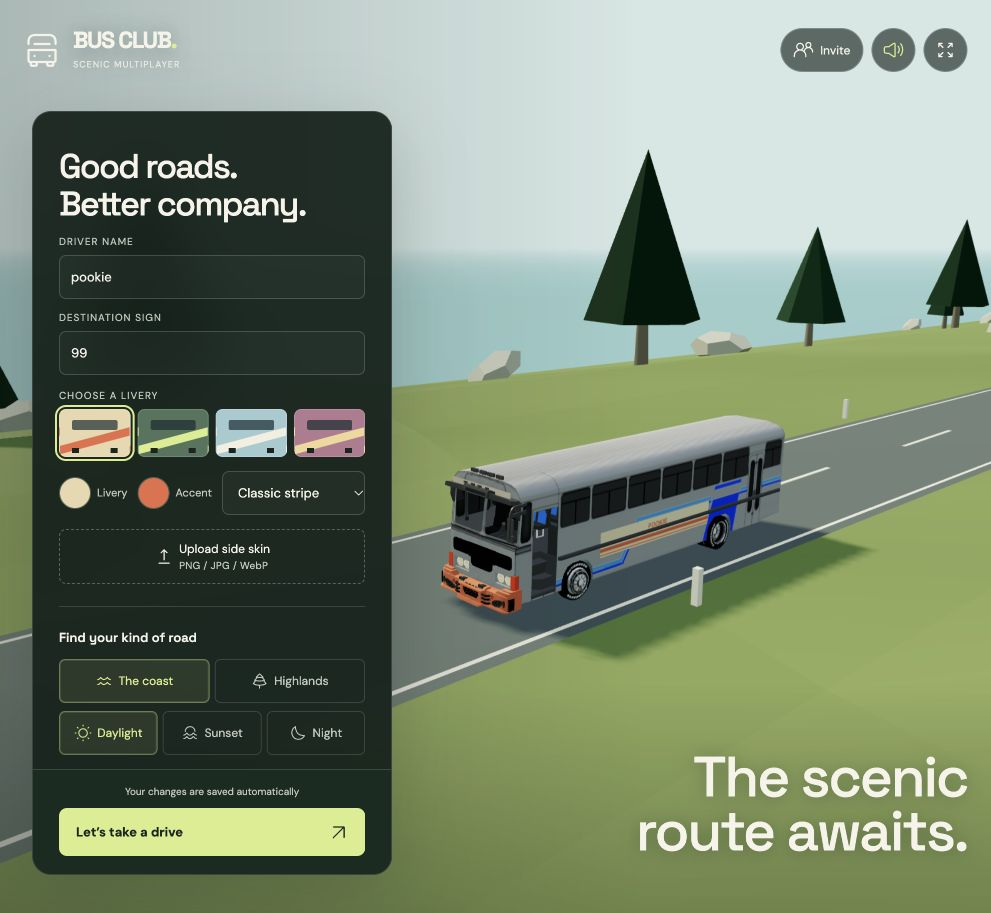
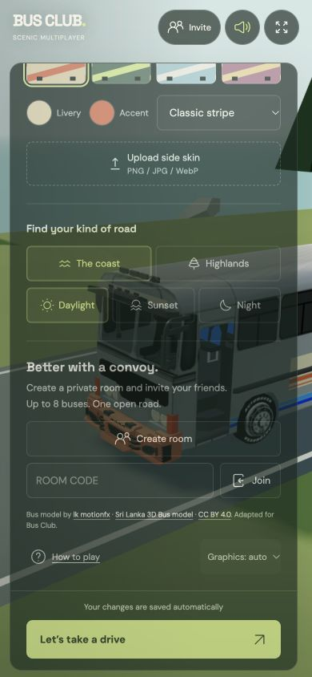
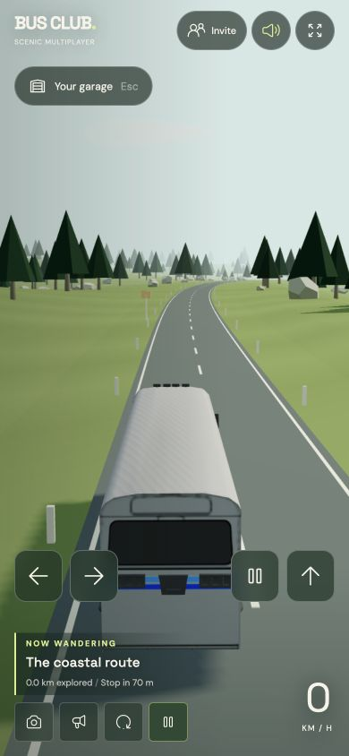
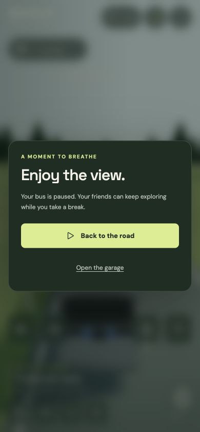
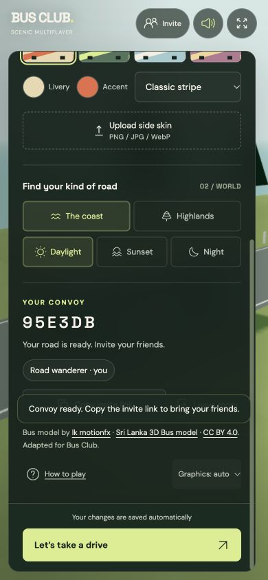
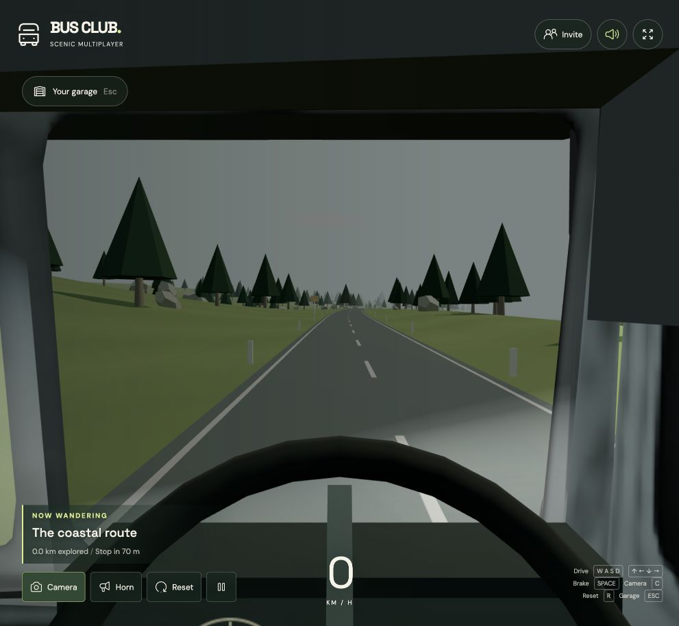
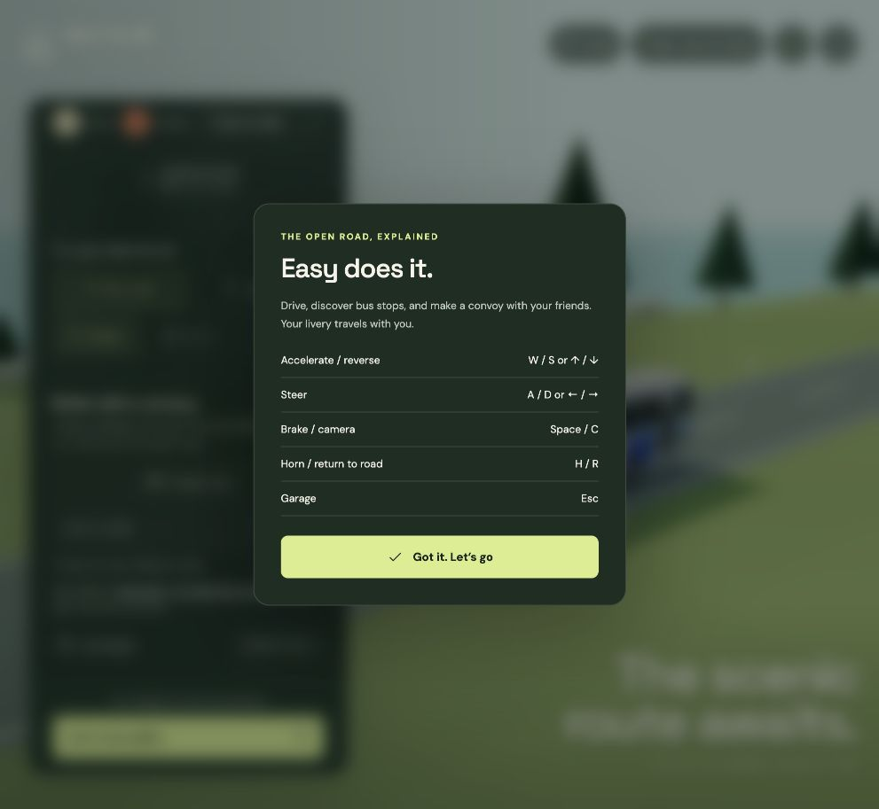

# Bus Club interface review — 24 October 2026

Scope: existing garage, driving HUD, convoy entry, pause/help dialogs. Reviewed with
screenshots and browser interactions at the default desktop viewport and 390×844 /
320×740 phone viewports. Four agents contributed layout, interaction, regression,
and bus physics reviews. Existing green/cream/lime styling was preserved.

1. **Garage — improved, verified.** Iconoir replaces text-symbol icons. Labels and
   controls are more legible; upload is now a keyboard-operable button. Drive stays
   visible as settings scroll. The compact header fits a 320 px phone. Screenshot:
   `02-garage-mobile.png`, `08-garage-desktop.png`. The garage still scrolls on small
   screens so the game retains its existing scope and customization options.
2. **Driving — improved, verified.** Touch controls and the single-row icon HUD no
   longer collide with route information. Keyboard acceleration reached 13 km/h in
   a short hold, braking stopped the bus, and camera switching was exercised.
   Corrected the larger model's driver camera to clear its visor and divider.
   Screenshots: `03-driving-mobile.png`, `06-driver-view.png`.
3. **Convoy — improved, verified.** Empty room code receives inline error feedback;
   Create/Join stay pending until acknowledgement with a timeout. Created a real
   local room and verified focus moves to Copy invite link. Membership/profile
   broadcasts no longer repeat connection announcements. Connection lifecycle
   tests cover acknowledgement, cancellation, errors and closure. Screenshot:
   `05-convoy-mobile.png`. Room was closed after the check.
4. **Pause/help — improved, verified.** Background controls become inert, focus is
   contained and returns on dismissal. Escape while editing a name leaves the
   garage open; driving shortcuts no longer consume form/button keyboard input.
   Screenshots: `04-pause-mobile.png`, `07-help-desktop.png`.

Other fixes: serialized sound toggles, audio failure rollback, model loading/fallback
feedback, fuller upload-format labels, clearer links, larger targets, reduced-motion
support retained, safe-area spacing and scrollable dialogs. Official Iconoir SVGs
are bundled locally with the MIT license (`src/icons/LICENSE`).

Validation: production build succeeds; all 33 automated tests pass, including real
local WebSocket clients, spawn footprints and handling. No browser warnings/errors
were recorded at the final check. Native file chooser keyboard activation, screen
reader output, exact contrast ratios, fullscreen permissions and physical mobile
touch hardware were not exhaustively tested; no full WCAG compliance claim is made.

Follow-up annotations: removed the eyebrow, intro, Garage heading/section numbers, solo note, world caption subtitle and visible status pill; smaller model credit; subtle transform-only Drive hover (reduced motion respected). Defaults are pookie / 99. Audio now synthesizes diesel pulses, load/gears, road noise, pneumatic brake release and a dual horn; these are synthesized sounds, not field recordings.
